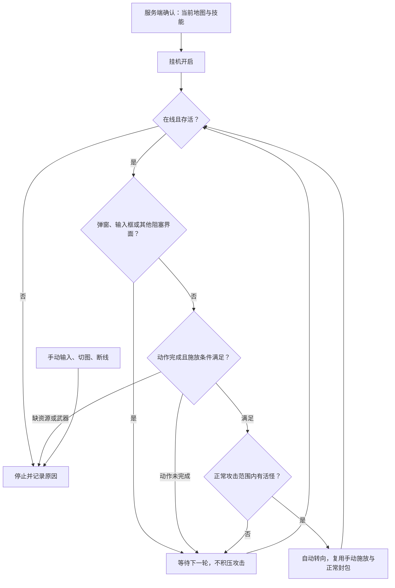

# 原地在线挂机与吸怪配套客户端

更新于 2026-11-23。首版代码、macOS 构建与自动检查通过，尚未部署/联机验收。分支：`codex/training-assist-client`；不包含原工作区尚未提交的汉化改动。

## 界面操作（优先入口）

进入游戏后点击右上角 **辅助设置 · F8**，或按 **F8** 展开/收起面板，无需输入命令。

- 四个独立开关：角色无敌、怪物沉默（含 Boss）、普通怪吸取、原地在线挂机。
- 点击“挂机技能”轮换普通攻击和海盗一转三个支持技能；开启挂机时固定技能，需先关闭再更换。
- 点击吸怪参数轮换：范围 200 / 400 / 800、数量 5 / 10 / 20；服务端校验范围 200–800、数量 1–20。设置即时提交，当前会话生效，不自动开启功能。
- 开关显示服务端确认状态，等待回执期间禁用重复提交；未开放训练的地图禁用开启操作；无状态或超时显示未同步，可点“刷新状态”。展开时每两秒同步一次。
- “一键停止全部辅助”关闭自己的免伤、吸怪、挂机及当前地图沉默；沉默影响全图，其他玩家个人辅助不变。
- 展开面板暂停挂机，收起后继续；F8 和面板内点击不再触发手动停止，其他键鼠/游戏操作仍停止挂机。当前是固定在右上角的可收起面板，入口不依赖额外贴图。
- 快速战斗 / 无延迟标为“待实现”，没有虚假开关。无中文字体的平台需配置 `FontPathCJK`；macOS 已加入系统中文字体回退。

下面的命令保留用于兼容旧客户端和排查，日常用面板即可。

## 使用条件与命令

配套 Cosmic `codex/training-assist` 代码，服务端必须将当前地图列入 `TRAINING_ASSIST_MAPS`。保持客户端在线且角色存活。

```text
@assist vac on
@assist auto on
@assist auto on 5001001
@assist auto off
@assist vac off
@assist status
@assist off
```

- 默认 `auto on` 为普通攻击；技能模式另支持已学的 5001001（Flash Fist）、5001002（Somersault Kick）、5001003（Double Shot）。通过命令选择一种，不会轮换技能。
- 原地选怪、自动转向、按正常攻击动作施放，不自动走路/捡物/喝药。缺武器、MP、弹药或其他技能条件不满足会停止，并在聊天栏显示原因。
- 除 F8 和辅助面板内操作外，键盘、游戏按键或鼠标点击停止挂机；弹窗、交易、商店、设置和文本输入聚焦时暂停。死亡、切图、断线关闭；重新登录不会恢复。窗口失焦本身不停止，但仍必须在线运行。
- 吸怪由服务端执行，旧客户端也可使用；每秒聚集 800 单位内最多 20 只普通可移动怪，排除 Boss 与固定机关怪。同地图仅一个吸怪会话，停用后不送回出生点。挂机停止不会自动停止独立开启的吸怪。
- `@assist off` 关闭自己的辅助并关闭当前地图沉默。服务器状态中的挂机技能是已下发指令；旧客户端不支持执行该指令。



## 构建与检查

```bash
cmake -S . -B build-training -DCMAKE_BUILD_TYPE=Release
cmake --build build-training -j 6
codesign --verify --deep --strict build-training/OpenStory.app
python3 tests/training-panel.py
c++ -std=c++17 tests/training-auto.cpp -o /tmp/maple-training-auto-test
/tmp/maple-training-auto-test
python3 tests/pirate-skill-data.py --build-dir build-training --data-dir wz
```

本机独立应用：`build-training/OpenStory.app`。本工作树 `wz/*.nx` 链接复用原工作区资源，配置、可执行文件和构建目录独立；默认连接 `127.0.0.1:8484`，仍需匹配测试服务和隧道。应用未自动启动，未覆盖原客户端或程序坞入口。

检查已通过：完整 macOS 构建、应用签名、生产 Skill.nx 分类/范围/武器要求，以及生产挂机状态对象的通知解析、地图校验、非法技能、启停与定时行为。通知复用现有私有服务器消息（版本 v1），无新增封包 opcode。服务端完整测试 1903 项通过。

联机待验收：左右目标实际掉血与经验、正常攻速、无怪不空放、MP/弹药耗尽停止、弹窗暂停、键鼠停止、切图和重连清理；吸怪需检查有效地面、控制权交接及其他玩家所见。普通近战使用保守寻敌窗口，实际挥击范围仍由原战斗代码决定；未验证的职业技能后续逐项扩展。未部署到 `my4g`。


面板验证：`tests/training-panel.py` 链接真实生产 UI、字体和图形对象，在临时 Settings 与窗口中验证折叠/展开、控件边界、地图未开放时禁用、等待确认时禁用、四项开关、技能选择、范围/数量请求和一键停止，并输出截图到 `build-training/panel-check/`。已目视检查中文渲染；未连接服务端。状态解析单测另覆盖错误地图、非法范围、尾随垃圾、清理与过期机制。服务端补充面板状态回包、参数上下限与吸怪命令不立即停止的回归。联机仍需验证真实状态同步、拒绝开启提示、F8 与设置时暂停、技能条件不足停止、其他玩家改变地图沉默时面板刷新。


界面风格更新：辅助面板复用 `UIWindow2.img/UserList/Group` 的银色圆角窗框与浅色纹理底板，以及 `Basic.img` 的按钮状态、关闭按钮和复选框。拼接保留原资源边角与纹理，避开原贴图里的英文标题/按钮文字，再绘制中文标签；不改动 UI.nx 文件。已通过生产 UI 截图复核及既有按钮交互检查；功能与服务端规则不变。


## 2026-11-23 实际部署记录（以本节为准）

已按用户要求将服务端配置设为 `TRAINING_ASSIST_MAPS: "*"`，全部地图允许手动开启辅助；空字符串仍表示全部禁用，地图 ID 列表仍可用。功能不自动开启；吸怪仍排除 Boss 与固定机关怪。

- `my4g:/opt/maple-poc/cosmic` 已更新辅助功能应用类与相关源码，保留现有 jar 的依赖与此前传送/VIP/地图改动，未覆盖数据库、脚本或其他运行配置。更新前已完成正常关服流程。
- 登录/频道服务重启成功，容器日志确认 Cosmic online，远端 18484/17575 均接受连接。完整测试 1904 项通过。
- 主客户端 `/Users/zubin/IdeaProjects/maple/OpenStory` 已在保留现有汉化和登录资源修复的基础上合入辅助面板；`build-macos/OpenStory.app` 已构建、签名校验并启动。
- 合并版本的面板真实渲染/交互测试和汉化回归通过；实际运行已观察角色进入地图、面板显示允许辅助，免伤与吸怪收到服务端开启确认。尚未完成持续战斗、经验、伤害反射及 Boss 沉默的完整联机验收。
- 远端部署目录与旧包备份：`/opt/maple-poc/training-assist-20261123/`，旧 jar/config/source 位于 `backup/`；回滚入口为该目录的 `rollback.sh`（执行会重启 game）。
- 客户端集成前源码备份：`/var/folders/1w/cpwn9tps2j92xsg4d5lq1vym0000gn/T/maple-client-integration-nqr0y5tx/original/`。Git 工作区改动尚未提交。
