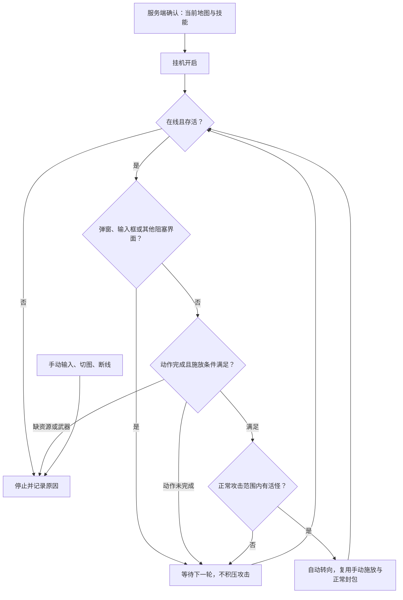

# 原地在线挂机与吸怪配套客户端

更新于 2026-11-23。本轮定点吸怪修复以 `/Users/zubin/IdeaProjects/maple/client/OpenStory` 的 `f9943898150419a7a88cb30cd78de082734929bc` 为基线。macOS 构建与自动检查通过，尚未部署/联机验收。

## 界面操作（优先入口）

进入游戏后点击右上角 **辅助设置 · F8**，或按 **F8** 展开/收起面板，无需输入命令。

- 四个独立开关：角色无敌、怪物沉默（含 Boss）、普通怪吸取、原地在线挂机。
- 点击“挂机技能”轮换普通攻击和海盗一转三个支持技能；开启挂机时固定技能，需先关闭再更换。
- 点击吸怪参数轮换：范围 200 / 400 / 800、数量 5 / 10 / 20；服务端校验范围 200–800、数量 1–20。设置即时提交，当前会话生效，不自动开启功能。
- 开关显示服务端确认状态，等待回执期间禁用重复提交；未开放训练的地图禁用开启操作；无状态或超时显示未同步，可点“刷新状态”。展开时每两秒同步一次。
- “一键停止全部辅助”关闭自己的免伤、吸怪、挂机及当前地图沉默；沉默影响全图，其他玩家个人辅助不变。
- 展开面板暂停挂机，收起后继续；F8 和面板内点击不再触发手动停止，其他键鼠/游戏操作仍停止挂机。当前是固定在右上角的可收起面板，入口不依赖额外贴图。
- 快速战斗 / 无延迟标为“待实现”，没有虚假开关。无中文字体的平台需配置 `FontPathCJK`；macOS 已加入系统中文字体回退。

下面的命令保留用于兼容旧客户端和排查，日常用面板即可。

## 使用条件与命令

配套 Cosmic `codex/training-assist` 代码，服务端必须将当前地图列入 `TRAINING_ASSIST_MAPS`。保持客户端在线且角色存活。

```text
@assist vac on
@assist auto on
@assist auto on 5001001
@assist auto off
@assist vac off
@assist status
@assist off
```

- 默认 `auto on` 为普通攻击；技能模式另支持已学的 5001001（Flash Fist）、5001002（Somersault Kick）、5001003（Double Shot）。通过命令选择一种，不会轮换技能。
- 原地选怪、自动转向、按正常攻击动作施放，不自动走路/捡物/喝药。缺武器、MP、弹药或其他技能条件不满足会停止，并在聊天栏显示原因。
- 除 F8 和辅助面板内操作外，键盘、游戏按键或鼠标点击停止挂机；弹窗、交易、商店、设置和文本输入聚焦时暂停。死亡、切图、断线关闭；重新登录不会恢复。窗口失焦本身不停止，但仍必须在线运行。
- 吸怪由服务端负责资格、范围和聚集，配套客户端收到确认后把最多 20 只普通可移动怪固定在开启时的锚点；每只怪只定位一次，控制器移动、击退和旧移动包不会让它走开或反复跳动。排除 Boss 与固定机关怪。同地图仅一个吸怪会话，停用后不送回出生点。挂机停止不会自动停止独立开启的吸怪。
- `@assist off` 关闭自己的辅助并关闭当前地图沉默。服务器状态中的挂机技能是已下发指令；旧客户端不支持执行该指令。



## 构建与检查

```bash
cmake -S . -B build-training -DCMAKE_BUILD_TYPE=Release
cmake --build build-training -j 6
codesign --verify --deep --strict build-training/OpenStory.app
python3 tests/training-panel.py
c++ -std=c++17 tests/training-auto.cpp -o /tmp/maple-training-auto-test
/tmp/maple-training-auto-test
python3 tests/pirate-skill-data.py --build-dir build-training --data-dir wz
```

本机独立应用：`build-training/OpenStory.app`。本工作树 `wz/*.nx` 链接复用原工作区资源，配置、可执行文件和构建目录独立；默认连接 `127.0.0.1:8484`，仍需匹配测试服务和隧道。应用未自动启动，未覆盖原客户端或程序坞入口。

检查已通过：完整 macOS 构建、应用签名、生产 Skill.nx 分类/范围/武器要求，以及生产挂机状态对象的通知解析、地图校验、非法技能、启停与定时行为。通知复用现有私有服务器消息（版本 v1），无新增封包 opcode。服务端完整测试 1903 项通过。

联机待验收：左右目标实际掉血与经验、正常攻速、无怪不空放、MP/弹药耗尽停止、弹窗暂停、键鼠停止、切图和重连清理；吸怪需检查有效地面、控制权交接及其他玩家所见。普通近战使用保守寻敌窗口，实际挥击范围仍由原战斗代码决定；未验证的职业技能后续逐项扩展。未部署到 `my4g`。


面板验证：`tests/training-panel.py` 链接真实生产 UI、字体和图形对象，在临时 Settings 与窗口中验证折叠/展开、控件边界、地图未开放时禁用、等待确认时禁用、四项开关、技能选择、范围/数量请求和一键停止，并输出截图到 `build-training/panel-check/`。已目视检查中文渲染；未连接服务端。状态解析单测另覆盖错误地图、非法范围、尾随垃圾、清理与过期机制。服务端补充面板状态回包、参数上下限与吸怪命令不立即停止的回归。联机仍需验证真实状态同步、拒绝开启提示、F8 与设置时暂停、技能条件不足停止、其他玩家改变地图沉默时面板刷新。


界面风格更新：辅助面板复用 `UIWindow2.img/UserList/Group` 的银色圆角窗框与浅色纹理底板，以及 `Basic.img` 的按钮状态、关闭按钮和复选框。拼接保留原资源边角与纹理，避开原贴图里的英文标题/按钮文字，再绘制中文标签；不改动 UI.nx 文件。已通过生产 UI 截图复核及既有按钮交互检查；功能与服务端规则不变。


## 2026-11-23 实际部署记录（以本节为准）

已按用户要求将服务端配置设为 `TRAINING_ASSIST_MAPS: "*"`，全部地图允许手动开启辅助；空字符串仍表示全部禁用，地图 ID 列表仍可用。功能不自动开启；吸怪仍排除 Boss 与固定机关怪。

- `my4g:/opt/maple-poc/cosmic` 已更新辅助功能应用类与相关源码，保留现有 jar 的依赖与此前传送/VIP/地图改动，未覆盖数据库、脚本或其他运行配置。更新前已完成正常关服流程。
- 登录/频道服务重启成功，容器日志确认 Cosmic online，远端 18484/17575 均接受连接。完整测试 1904 项通过。
- 主客户端 `/Users/zubin/IdeaProjects/maple/client/OpenStory` 已在保留现有汉化和登录资源修复的基础上合入辅助面板；`build-macos/OpenStory.app` 已构建、签名校验并启动。
- 合并版本的面板真实渲染/交互测试和汉化回归通过；实际运行已观察角色进入地图、面板显示允许辅助，免伤与吸怪收到服务端开启确认。尚未完成持续战斗、经验、伤害反射及 Boss 沉默的完整联机验收。
- 远端部署目录与旧包备份：`/opt/maple-poc/training-assist-20261123/`，旧 jar/config/source 位于 `backup/`；回滚入口为该目录的 `rollback.sh`（执行会重启 game）。
- 客户端集成前源码备份：`/var/folders/1w/cpwn9tps2j92xsg4d5lq1vym0000gn/T/maple-client-integration-nqr0y5tx/original/`。Git 工作区改动尚未提交。


## 定点吸怪修正（2026-11-23，尚未部署）

本轮按反馈将吸怪改成“固定怪物堆”：服务端在开启时复制玩家当前位置并确定合法落脚点，之后玩家移动不改变选怪中心或目标坐标；无合法落脚点则拒绝开启。重新选点需先关闭再开启。普通怪拉入后持续固定，停止吸怪/离图/断线/死亡时释放；吸怪数量为同时固定数量上限，新怪在空出名额后补入，Boss 与固定机关怪仍排除。

服务端拦截已固定怪物的移动请求并暂停控制权交接，通过 `[TrainingAssist:pin:v1] <地图> <怪物OID> <开关> <x> <y>` 广播固定/释放状态，状态查询附带当前固定怪物快照。客户端只采用服务端明确的怪物和坐标，不再用玩家当下位置独立选怪；固定期间清除水平/垂直速度与外力、暂停 AI 和物理移动、忽略旧移动包与击退，保持待机和死亡动画，避免反复传送造成跳动。重复状态同步不会重设待机动画。

已通过服务端完整 1909 项测试（含锚点不随玩家移动、数量限制、停止释放、旧控制请求拦截），客户端应用构建/签名与无窗口状态测试通过；生产怪物回归检查程序已编译，但遵照用户手动启动测试的要求，本轮未启动游戏或测试窗口，也未部署/重启 my4g。

本机客户端产物仍为 `/Users/zubin/IdeaProjects/maple/client/OpenStory/build-macos/OpenStory.app`；服务端新包在 `/Users/zubin/.codex/worktrees/cosmic-training-assist/Cosmic/target/Cosmic.jar`。这次需要配套更新服务端才能完整启用固定逻辑，仅重启客户端不足以更新远端。实际游戏内走开/跳跃、多人同步和关停恢复由用户继续测试。


## 定点固定修正版部署（2026-11-23）

已按用户要求更新至 `my4g:/opt/maple-poc/cosmic`，部署目录 `/opt/maple-poc/training-pin-20261123`，旧 jar、配置及受影响源码备份在其 `backup/` 下。保留 `TRAINING_ASSIST_MAPS: "*"` 和现有依赖，仅更新辅助相关应用类及源码。服务正常关停后重启；客户端已构建并签名，未自动启动，用户手动重启 `/Users/zubin/IdeaProjects/maple/client/OpenStory/build-macos/OpenStory.app` 后测试。吸怪需重新关闭再开启以建立固定点；预期人物离开后怪堆不跟随、不走跳，关闭后释放。


## 全图不限数量与计数（2026-11-23，待部署）

吸怪已改为当前地图实例内全部存活、可移动的普通怪物：不再检查距离，也没有同时固定只数上限。包含上下层与远处怪物，新刷怪每秒补入，目标始终是开启时锁定的落脚点。Boss、固定机关怪及已死亡怪物继续排除。

面板移除范围和数量轮换按钮，明确显示“全图吸怪 · 数量不限”，并显示“已吸入 N / 可吸 M 只”；收起后的辅助入口显示“已吸 N 只 · F8”。N 是当前地图仍存活且已固定的可吸怪数，M 是同地图全部可吸怪数，不是累计击杀或累计刷怪数。关闭时固定数归零，Boss 等排除对象不计入 M。服务端每秒向吸怪玩家推送 `[TrainingAssist:vac-count:v1] <地图> <已固定> <可吸总数>`，面板刷新也返回该统计；旧状态格式中的范围/数量字段用 `0 0` 表示全图/不限数量。

服务端完整测试 1910 项通过，新增/调整覆盖远处目标、125 只全部固定、新怪补位及排除对象统计；客户端构建、签名、无窗口状态解析测试通过，生产面板/怪物回归程序已编译。本轮未启动应用或图形测试窗口，尚未部署到 my4g。需配套更新服务端，再手动重启主工作区应用后验证。


## 全图不限数量版已部署（2026-11-23）

核查发现远端仍在运行旧的 800 距离 / 20 只限制版本，现已部署全图不限数量及数量统计功能。部署目录 `my4g:/opt/maple-poc/training-fullmap-20261123`，旧 jar/配置/源码保存在 `backup/`，保留现有配置与依赖，仅更新四个相关应用类及内部类。服务端已正常重启，日志确认 online，18484/17575 登录与频道握手通过。

本地工作区已迁移，主应用当前位于 `/Users/zubin/IdeaProjects/maple/client/OpenStory/build-macos/OpenStory.app`，签名检查通过。用户手动重启此应用后重新开启吸怪，面板应显示“全图吸怪 · 数量不限”和“已吸入 N / 可吸 M 只”；Boss/固定机关怪仍排除。此记录取代前文“全图版尚未部署”的状态，本轮未启动客户端或代替用户进行游戏内操作。


## 装备职业误判修复（2026-11-23）

海盗角色穿戴拳套时出现“Your current job cannot equip the selected item”，原因是背包穿戴校验把装备 `reqJob` 位掩码（海盗为 16）误当作职业树编号（海盗为 500）传给 `is_sub_job`。该路径不涉及汉化文本匹配。现新增独立的装备职业判定，背包双击/拖拽及装备说明/对比预览统一使用；支持组合职业掩码、初心者专用、骑士团和战神职业分支，技能职业树校验保持原逻辑。

`tests/equipment-job.cpp` 回归通过，覆盖海盗拳套、其他职业拒绝、组合掩码、进阶职业及技能判定；macOS 应用构建和签名检查通过。无需服务端更新，用户手动重启 `build-macos/OpenStory.app` 后复测穿戴；本轮未启动客户端或进行游戏内操作。


## 窗口与汉化按钮显示修正（2026-11-23）

窗口尺寸与游戏分辨率分开处理：窗口模式按桌面工作区等比缩小并居中，可拖动边缘调整大小；启动适配不再覆盖 Settings 的 Width/Height。Alt+Enter 使用 GLFW 的显示器全屏模式，切回时恢复窗口大小和位置；取消“大分辨率自动进入全屏”的隐式行为。每帧按实际 framebuffer 更新等比视口，比例不同时保留黑边，鼠标使用相同视口换算，兼容 Retina 缩放和窗口尺寸变化。

汉化通用按钮改为从原贴图无字的左侧留白采样渐变，不再从英文及阴影所在区域取色，消除内部横条，保留原边框、配色及各交互状态。

`tests/window-layout.cpp` 覆盖宽屏、竖屏、Retina 尺寸与无效尺寸；`tests/localization-settings.py` 生产对象离线渲染/交互测试通过，新增窗口调整、实际全屏往返、恢复尺寸与分辨率设置不被覆盖的检查。已检查键位设置与系统设置中文截图，macOS 应用构建和签名验证通过。本轮仅运行离线测试窗口，未登录游戏；用户手动重启主应用复测。


## 创建角色入口显示修复（2026-11-23）

截图中仅剩森林背景和返回按钮的是职业选择页。当前 v154 UI.nx 缺少 Login.img/RaceSelect，现复用 UI.Login.nx 中既有 v83 资源，恢复冒险家、骑士团、战神插画、职业说明及选择按钮；主游戏 UI 包与后续外观设置页资源保持现有配置。

`tests/race-select.py` 使用生产 UI 对象离线渲染三种职业并点击卡片，截图复核通过；macOS 应用构建与签名检查通过。未连接服务端或重启主游戏，用户手动重启 build-macos/OpenStory.app 后复测创建角色入口。


## 中文按钮立体反馈恢复（2026-11-23）

按用户确认的第三列预览恢复中文通用按钮的立体文字阴影，并让按下状态的文字向下移动一个逻辑像素。正常、悬停、按下和禁用仍使用各自原始资源帧，渐变使用已修正的无字区域采样；仅通用按钮启用文字阴影，其他汉化标题/标签保留原绘制方式。

生产渲染对比确认：还原/确定两类按钮共 8 个状态与已确认预览逐 PNG 文件完全一致。既有汉化离线渲染、交互及窗口/全屏回归通过，macOS 应用重新构建、签名验证通过。未启动主游戏或连接服务端，用户手动重启 `build-macos/OpenStory.app` 后体验。

## 海盗“疾”双击方向键修复（2026-11-23）

补上同方向左右键 300ms 内两次独立按下触发“疾”（5001005 / 15001003）；长按键盘重复事件不计为双击，换方向或切地图重置候选。技能学习等级、MP、冷却及可行动条件继续走原有 Combat 校验与服务端 USE_SKILL。

客户端新增 DASH2（速度）/DASH（跳跃）属性应用，并按主服务端 `src/main/java/tools/PacketCreator.java::givePirateBuff` 与 `server/StatEffect.java` 的实际格式处理双属性 Buff：前导 short、每项 int 数值/int 技能/5 字节保留/short 秒数，严格按速度→跳跃读取，秒转毫秒。不再把专用包按普通 10 字节 Buff 解析。本轮仅对照主工程协议，未引入参考库代码，无服务端修改。

macOS 构建、海盗技能真实 NX 数据回归和应用签名验证通过；尚未登录游戏验证双击及服务器 Buff 往返。需手动重启 `build-macos/OpenStory.app` 后，以快速按两次同一方向（第一次松开，第二次可按住）复测。

## 商店回车确认（2026-11-23）

选中购买商品后按 Enter 打开原有购买数量/确认窗口；活动 NOTICE 弹窗优先于底层商店接收 Enter/Esc，避免单件购买确认或输入框失焦后回车被商店吞掉。数量窗口仅响应按下，提交沿用“确定”按钮相同校验，不再额外关闭校验错误弹窗。

macOS 构建、签名检查和 `tests/localization-settings.py` 生产对象离线回归通过，新增数量窗口回车松开不提交、按下确认的检查。未执行实际游戏购买；重启主应用生效。

## 角色命名格式与误报修复（2026-11-23）

当前 Cosmic 的 Character.canCreateChar 仅允许 [a-zA-Z0-9]{3,12}，格式不符与已占用共用拒绝回包，因此中文名字此前被客户端误报为“已被使用”。客户端现在提交前校验同一格式，以中英文明确提示当前服务器不支持中文、空格和符号；允许原先客户端误拒绝的 3 位合法名字，禁用词独立提示。未修改服务端规则或部署服务端。

`tests/character-name.cpp` 验证 ASCII、中文、符号及长度边界；`tests/character-naming.py` 用生产创建角色对象验证非法输入、中英文提示及关闭后恢复输入，截图复核通过。macOS 应用构建与签名通过；未登录或创建测试角色，需手动重启 build-macos/OpenStory.app。提交前先解除输入框焦点再禁用，避免解除焦点过程将 DISABLED 回写成 NORMAL。

## 初始背包与点券扩容（2026-11-23）

按用户确认，装备、消耗、设置、其他初始容量从 24 扩为 96 格；现金栏原本为 96 格。现有角色各栏不足 96 的一次性补齐，保留更高容量。新账号默认赠送 1,000,000 NX Credit 点券，现有账号不足的补齐到此余额，保留更高余额；不修改 Maple Point / NX Prepaid，不在登录或重启时重复补发。

新增显式加载的 Liquibase 迁移 `db/changes/20261123-starter-benefits.sql`，同步角色创建默认值。客户端滚动条按已解锁容量计算，空背包也能滚动浏览后续格子。服务端部署目录 `my4g:/opt/maple-poc/starter-benefits-20261123`，原 jar、源码、配置与停服后的账号/角色数据备份位于 `backup/`。仅替换基于远端现有源码编译的 Character 类及数据库迁移资源，保留其他线上功能。

macOS 构建、签名及现有离线 UI 回归通过；服务端 Java 21 编译通过，线上迁移记录确认为 EXECUTED，3 个角色各栏均为 96，4 个账号 NX Credit 均为 1,000,000。需重启主工作区应用并重新登录，客户端滚动修正才会生效。本轮未代替用户创建账号、购买商城物品或进行游戏内操作。


## NPC 对话快捷键修复（2026-11-23）

“NPC 对话 / 采集”（INTERACT_HARVEST，54）此前只显示在键位设置中，Stage 未实现交互动作；默认模板又将其标为 MENU，与设置页保存时采用的 ACTION 不一致。现默认模板统一为 ACTION，游戏输入兼容已有 MENU 绑定，并触发附近 NPC 对话。按键选择水平 150、垂直 80 地图像素范围内最近的活动 NPC，同距离按 OID 稳定选择，排除 talkMouseOnly；与鼠标共用原有请求、600ms 冷却及响应跟踪。该动作不锁存在 Player 按住状态，避免对话窗口吞掉松键后无法再次交互。未添加 v83 不具备的采集系统。

`tests/npc-interaction.py` 使用生产 NPC/MapNpcs 与本机 NX 验证空地图、距离边界、最近目标、同距、移除、清图及冷却；macOS 应用构建和签名检查通过。未登录或发起实际 NPC 对话。用户手动重启 build-macos/OpenStory.app，关闭键位设置后靠近 NPC，按已绑定的 NPC 对话键（截图为 Y）复测；鼠标双击仍可用。无需修改或部署服务端。
