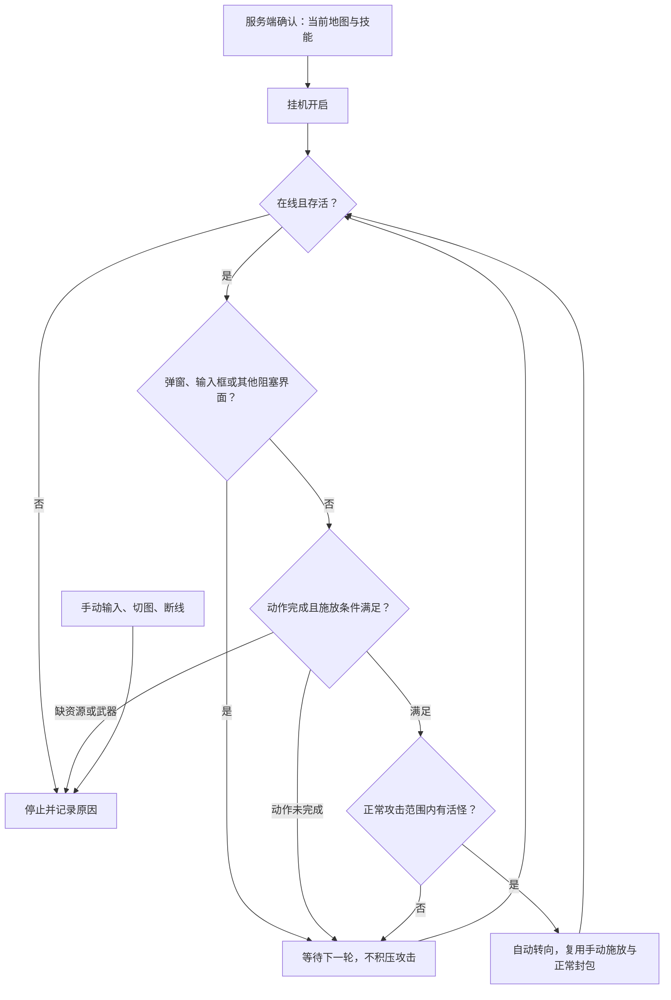

# 原地在线挂机与吸怪配套客户端

更新于 2026-11-23。本轮定点吸怪修复以 `/Users/zubin/IdeaProjects/maple/client/OpenStory` 的 `f9943898150419a7a88cb30cd78de082734929bc` 为基线。macOS 构建与自动检查通过，尚未部署/联机验收。

## 界面操作（优先入口）

进入游戏后点击右上角 **辅助设置 · F8**，或按 **F8** 展开/收起面板，无需输入命令。

- 四个独立开关：角色无敌、怪物沉默（含 Boss）、普通怪吸取、原地在线挂机。
- 点击“挂机技能”轮换普通攻击和海盗一转三个支持技能；开启挂机时固定技能，需先关闭再更换。
- 点击吸怪参数轮换：范围 200 / 400 / 800、数量 5 / 10 / 20；服务端校验范围 200–800、数量 1–20。设置即时提交，当前会话生效，不自动开启功能。
- 开关显示服务端确认状态，等待回执期间禁用重复提交；未开放训练的地图禁用开启操作；无状态或超时显示未同步，可点“刷新状态”。展开时每两秒同步一次。
- “一键停止全部辅助”关闭自己的免伤、吸怪、挂机及当前地图沉默；沉默影响全图，其他玩家个人辅助不变。
- 展开面板暂停挂机，收起后继续；F8 和面板内点击不再触发手动停止，其他键鼠/游戏操作仍停止挂机。当前是固定在右上角的可收起面板，入口不依赖额外贴图。
- 快速战斗 / 无延迟标为“待实现”，没有虚假开关。无中文字体的平台需配置 `FontPathCJK`；macOS 已加入系统中文字体回退。

下面的命令保留用于兼容旧客户端和排查，日常用面板即可。

## 使用条件与命令

配套 Cosmic `codex/training-assist` 代码，服务端必须将当前地图列入 `TRAINING_ASSIST_MAPS`。保持客户端在线且角色存活。

```text
@assist vac on
@assist auto on
@assist auto on 5001001
@assist auto off
@assist vac off
@assist status
@assist off
```

- 默认 `auto on` 为普通攻击；技能模式另支持已学的 5001001（Flash Fist）、5001002（Somersault Kick）、5001003（Double Shot）。通过命令选择一种，不会轮换技能。
- 原地选怪、自动转向、按正常攻击动作施放，不自动走路/捡物/喝药。缺武器、MP、弹药或其他技能条件不满足会停止，并在聊天栏显示原因。
- 除 F8 和辅助面板内操作外，键盘、游戏按键或鼠标点击停止挂机；弹窗、交易、商店、设置和文本输入聚焦时暂停。死亡、切图、断线关闭；重新登录不会恢复。窗口失焦本身不停止，但仍必须在线运行。
- 吸怪由服务端负责资格、范围和聚集，配套客户端收到确认后把最多 20 只普通可移动怪固定在开启时的锚点；每只怪只定位一次，控制器移动、击退和旧移动包不会让它走开或反复跳动。排除 Boss 与固定机关怪。同地图仅一个吸怪会话，停用后不送回出生点。挂机停止不会自动停止独立开启的吸怪。
- `@assist off` 关闭自己的辅助并关闭当前地图沉默。服务器状态中的挂机技能是已下发指令；旧客户端不支持执行该指令。



## 构建与检查

```bash
cmake -S . -B build-training -DCMAKE_BUILD_TYPE=Release
cmake --build build-training -j 6
codesign --verify --deep --strict build-training/OpenStory.app
python3 tests/training-panel.py
c++ -std=c++17 tests/training-auto.cpp -o /tmp/maple-training-auto-test
/tmp/maple-training-auto-test
python3 tests/pirate-skill-data.py --build-dir build-training --data-dir wz
```

本机独立应用：`build-training/OpenStory.app`。本工作树 `wz/*.nx` 链接复用原工作区资源，配置、可执行文件和构建目录独立；默认连接 `127.0.0.1:8484`，仍需匹配测试服务和隧道。应用未自动启动，未覆盖原客户端或程序坞入口。

检查已通过：完整 macOS 构建、应用签名、生产 Skill.nx 分类/范围/武器要求，以及生产挂机状态对象的通知解析、地图校验、非法技能、启停与定时行为。通知复用现有私有服务器消息（版本 v1），无新增封包 opcode。服务端完整测试 1903 项通过。

联机待验收：左右目标实际掉血与经验、正常攻速、无怪不空放、MP/弹药耗尽停止、弹窗暂停、键鼠停止、切图和重连清理；吸怪需检查有效地面、控制权交接及其他玩家所见。普通近战使用保守寻敌窗口，实际挥击范围仍由原战斗代码决定；未验证的职业技能后续逐项扩展。未部署到 `my4g`。


面板验证：`tests/training-panel.py` 链接真实生产 UI、字体和图形对象，在临时 Settings 与窗口中验证折叠/展开、控件边界、地图未开放时禁用、等待确认时禁用、四项开关、技能选择、范围/数量请求和一键停止，并输出截图到 `build-training/panel-check/`。已目视检查中文渲染；未连接服务端。状态解析单测另覆盖错误地图、非法范围、尾随垃圾、清理与过期机制。服务端补充面板状态回包、参数上下限与吸怪命令不立即停止的回归。联机仍需验证真实状态同步、拒绝开启提示、F8 与设置时暂停、技能条件不足停止、其他玩家改变地图沉默时面板刷新。


界面风格更新：辅助面板复用 `UIWindow2.img/UserList/Group` 的银色圆角窗框与浅色纹理底板，以及 `Basic.img` 的按钮状态、关闭按钮和复选框。拼接保留原资源边角与纹理，避开原贴图里的英文标题/按钮文字，再绘制中文标签；不改动 UI.nx 文件。已通过生产 UI 截图复核及既有按钮交互检查；功能与服务端规则不变。


## 2026-11-23 实际部署记录（以本节为准）

已按用户要求将服务端配置设为 `TRAINING_ASSIST_MAPS: "*"`，全部地图允许手动开启辅助；空字符串仍表示全部禁用，地图 ID 列表仍可用。功能不自动开启；吸怪仍排除 Boss 与固定机关怪。

- `my4g:/opt/maple-poc/cosmic` 已更新辅助功能应用类与相关源码，保留现有 jar 的依赖与此前传送/VIP/地图改动，未覆盖数据库、脚本或其他运行配置。更新前已完成正常关服流程。
- 登录/频道服务重启成功，容器日志确认 Cosmic online，远端 18484/17575 均接受连接。完整测试 1904 项通过。
- 主客户端 `/Users/zubin/IdeaProjects/maple/client/OpenStory` 已在保留现有汉化和登录资源修复的基础上合入辅助面板；`build-macos/OpenStory.app` 已构建、签名校验并启动。
- 合并版本的面板真实渲染/交互测试和汉化回归通过；实际运行已观察角色进入地图、面板显示允许辅助，免伤与吸怪收到服务端开启确认。尚未完成持续战斗、经验、伤害反射及 Boss 沉默的完整联机验收。
- 远端部署目录与旧包备份：`/opt/maple-poc/training-assist-20261123/`，旧 jar/config/source 位于 `backup/`；回滚入口为该目录的 `rollback.sh`（执行会重启 game）。
- 客户端集成前源码备份：`/var/folders/1w/cpwn9tps2j92xsg4d5lq1vym0000gn/T/maple-client-integration-nqr0y5tx/original/`。Git 工作区改动尚未提交。


## 定点吸怪修正（2026-11-23，尚未部署）

本轮按反馈将吸怪改成“固定怪物堆”：服务端在开启时复制玩家当前位置并确定合法落脚点，之后玩家移动不改变选怪中心或目标坐标；无合法落脚点则拒绝开启。重新选点需先关闭再开启。普通怪拉入后持续固定，停止吸怪/离图/断线/死亡时释放；吸怪数量为同时固定数量上限，新怪在空出名额后补入，Boss 与固定机关怪仍排除。

服务端拦截已固定怪物的移动请求并暂停控制权交接，通过 `[TrainingAssist:pin:v1] <地图> <怪物OID> <开关> <x> <y>` 广播固定/释放状态，状态查询附带当前固定怪物快照。客户端只采用服务端明确的怪物和坐标，不再用玩家当下位置独立选怪；固定期间清除水平/垂直速度与外力、暂停 AI 和物理移动、忽略旧移动包与击退，保持待机和死亡动画，避免反复传送造成跳动。重复状态同步不会重设待机动画。

已通过服务端完整 1909 项测试（含锚点不随玩家移动、数量限制、停止释放、旧控制请求拦截），客户端应用构建/签名与无窗口状态测试通过；生产怪物回归检查程序已编译，但遵照用户手动启动测试的要求，本轮未启动游戏或测试窗口，也未部署/重启 my4g。

本机客户端产物仍为 `/Users/zubin/IdeaProjects/maple/client/OpenStory/build-macos/OpenStory.app`；服务端新包在 `/Users/zubin/.codex/worktrees/cosmic-training-assist/Cosmic/target/Cosmic.jar`。这次需要配套更新服务端才能完整启用固定逻辑，仅重启客户端不足以更新远端。实际游戏内走开/跳跃、多人同步和关停恢复由用户继续测试。


## 定点固定修正版部署（2026-11-23）

已按用户要求更新至 `my4g:/opt/maple-poc/cosmic`，部署目录 `/opt/maple-poc/training-pin-20261123`，旧 jar、配置及受影响源码备份在其 `backup/` 下。保留 `TRAINING_ASSIST_MAPS: "*"` 和现有依赖，仅更新辅助相关应用类及源码。服务正常关停后重启；客户端已构建并签名，未自动启动，用户手动重启 `/Users/zubin/IdeaProjects/maple/client/OpenStory/build-macos/OpenStory.app` 后测试。吸怪需重新关闭再开启以建立固定点；预期人物离开后怪堆不跟随、不走跳，关闭后释放。


## 全图不限数量与计数（2026-11-23，待部署）

吸怪已改为当前地图实例内全部存活、可移动的普通怪物：不再检查距离，也没有同时固定只数上限。包含上下层与远处怪物，新刷怪每秒补入，目标始终是开启时锁定的落脚点。Boss、固定机关怪及已死亡怪物继续排除。

面板移除范围和数量轮换按钮，明确显示“全图吸怪 · 数量不限”，并显示“已吸入 N / 可吸 M 只”；收起后的辅助入口显示“已吸 N 只 · F8”。N 是当前地图仍存活且已固定的可吸怪数，M 是同地图全部可吸怪数，不是累计击杀或累计刷怪数。关闭时固定数归零，Boss 等排除对象不计入 M。服务端每秒向吸怪玩家推送 `[TrainingAssist:vac-count:v1] <地图> <已固定> <可吸总数>`，面板刷新也返回该统计；旧状态格式中的范围/数量字段用 `0 0` 表示全图/不限数量。

服务端完整测试 1910 项通过，新增/调整覆盖远处目标、125 只全部固定、新怪补位及排除对象统计；客户端构建、签名、无窗口状态解析测试通过，生产面板/怪物回归程序已编译。本轮未启动应用或图形测试窗口，尚未部署到 my4g。需配套更新服务端，再手动重启主工作区应用后验证。


## 全图不限数量版已部署（2026-11-23）

核查发现远端仍在运行旧的 800 距离 / 20 只限制版本，现已部署全图不限数量及数量统计功能。部署目录 `my4g:/opt/maple-poc/training-fullmap-20261123`，旧 jar/配置/源码保存在 `backup/`，保留现有配置与依赖，仅更新四个相关应用类及内部类。服务端已正常重启，日志确认 online，18484/17575 登录与频道握手通过。

本地工作区已迁移，主应用当前位于 `/Users/zubin/IdeaProjects/maple/client/OpenStory/build-macos/OpenStory.app`，签名检查通过。用户手动重启此应用后重新开启吸怪，面板应显示“全图吸怪 · 数量不限”和“已吸入 N / 可吸 M 只”；Boss/固定机关怪仍排除。此记录取代前文“全图版尚未部署”的状态，本轮未启动客户端或代替用户进行游戏内操作。


## 装备职业误判修复（2026-11-23）

海盗角色穿戴拳套时出现“Your current job cannot equip the selected item”，原因是背包穿戴校验把装备 `reqJob` 位掩码（海盗为 16）误当作职业树编号（海盗为 500）传给 `is_sub_job`。该路径不涉及汉化文本匹配。现新增独立的装备职业判定，背包双击/拖拽及装备说明/对比预览统一使用；支持组合职业掩码、初心者专用、骑士团和战神职业分支，技能职业树校验保持原逻辑。

`tests/equipment-job.cpp` 回归通过，覆盖海盗拳套、其他职业拒绝、组合掩码、进阶职业及技能判定；macOS 应用构建和签名检查通过。无需服务端更新，用户手动重启 `build-macos/OpenStory.app` 后复测穿戴；本轮未启动客户端或进行游戏内操作。


## 窗口与汉化按钮显示修正（2026-11-23）

窗口尺寸与游戏分辨率分开处理：窗口模式按桌面工作区等比缩小并居中，可拖动边缘调整大小；启动适配不再覆盖 Settings 的 Width/Height。Alt+Enter 使用 GLFW 的显示器全屏模式，切回时恢复窗口大小和位置；取消“大分辨率自动进入全屏”的隐式行为。每帧按实际 framebuffer 更新等比视口，比例不同时保留黑边，鼠标使用相同视口换算，兼容 Retina 缩放和窗口尺寸变化。

汉化通用按钮改为从原贴图无字的左侧留白采样渐变，不再从英文及阴影所在区域取色，消除内部横条，保留原边框、配色及各交互状态。

`tests/window-layout.cpp` 覆盖宽屏、竖屏、Retina 尺寸与无效尺寸；`tests/localization-settings.py` 生产对象离线渲染/交互测试通过，新增窗口调整、实际全屏往返、恢复尺寸与分辨率设置不被覆盖的检查。已检查键位设置与系统设置中文截图，macOS 应用构建和签名验证通过。本轮仅运行离线测试窗口，未登录游戏；用户手动重启主应用复测。


## 创建角色入口显示修复（2026-11-23）

截图中仅剩森林背景和返回按钮的是职业选择页。当前 v154 UI.nx 缺少 Login.img/RaceSelect，现复用 UI.Login.nx 中既有 v83 资源，恢复冒险家、骑士团、战神插画、职业说明及选择按钮；主游戏 UI 包与后续外观设置页资源保持现有配置。

`tests/race-select.py` 使用生产 UI 对象离线渲染三种职业并点击卡片，截图复核通过；macOS 应用构建与签名检查通过。未连接服务端或重启主游戏，用户手动重启 build-macos/OpenStory.app 后复测创建角色入口。


## 中文按钮立体反馈恢复（2026-11-23）

按用户确认的第三列预览恢复中文通用按钮的立体文字阴影，并让按下状态的文字向下移动一个逻辑像素。正常、悬停、按下和禁用仍使用各自原始资源帧，渐变使用已修正的无字区域采样；仅通用按钮启用文字阴影，其他汉化标题/标签保留原绘制方式。

生产渲染对比确认：还原/确定两类按钮共 8 个状态与已确认预览逐 PNG 文件完全一致。既有汉化离线渲染、交互及窗口/全屏回归通过，macOS 应用重新构建、签名验证通过。未启动主游戏或连接服务端，用户手动重启 `build-macos/OpenStory.app` 后体验。

## 海盗“疾”双击方向键修复（2026-11-23）

补上同方向左右键 300ms 内两次独立按下触发“疾”（5001005 / 15001003）；长按键盘重复事件不计为双击，换方向或切地图重置候选。技能学习等级、MP、冷却及可行动条件继续走原有 Combat 校验与服务端 USE_SKILL。

客户端新增 DASH2（速度）/DASH（跳跃）属性应用，并按主服务端 `src/main/java/tools/PacketCreator.java::givePirateBuff` 与 `server/StatEffect.java` 的实际格式处理双属性 Buff：前导 short、每项 int 数值/int 技能/5 字节保留/short 秒数，严格按速度→跳跃读取，秒转毫秒。不再把专用包按普通 10 字节 Buff 解析。本轮仅对照主工程协议，未引入参考库代码，无服务端修改。

macOS 构建、海盗技能真实 NX 数据回归和应用签名验证通过；尚未登录游戏验证双击及服务器 Buff 往返。需手动重启 `build-macos/OpenStory.app` 后，以快速按两次同一方向（第一次松开，第二次可按住）复测。

## 商店回车确认（2026-11-23）

选中购买商品后按 Enter 打开原有购买数量/确认窗口；活动 NOTICE 弹窗优先于底层商店接收 Enter/Esc，避免单件购买确认或输入框失焦后回车被商店吞掉。数量窗口仅响应按下，提交沿用“确定”按钮相同校验，不再额外关闭校验错误弹窗。

macOS 构建、签名检查和 `tests/localization-settings.py` 生产对象离线回归通过，新增数量窗口回车松开不提交、按下确认的检查。未执行实际游戏购买；重启主应用生效。

## 角色命名格式与误报修复（2026-11-23）

当前 Cosmic 的 Character.canCreateChar 仅允许 [a-zA-Z0-9]{3,12}，格式不符与已占用共用拒绝回包，因此中文名字此前被客户端误报为“已被使用”。客户端现在提交前校验同一格式，以中英文明确提示当前服务器不支持中文、空格和符号；允许原先客户端误拒绝的 3 位合法名字，禁用词独立提示。未修改服务端规则或部署服务端。

`tests/character-name.cpp` 验证 ASCII、中文、符号及长度边界；`tests/character-naming.py` 用生产创建角色对象验证非法输入、中英文提示及关闭后恢复输入，截图复核通过。macOS 应用构建与签名通过；未登录或创建测试角色，需手动重启 build-macos/OpenStory.app。提交前先解除输入框焦点再禁用，避免解除焦点过程将 DISABLED 回写成 NORMAL。

## 初始背包与点券扩容（2026-11-23）

按用户确认，装备、消耗、设置、其他初始容量从 24 扩为 96 格；现金栏原本为 96 格。现有角色各栏不足 96 的一次性补齐，保留更高容量。新账号默认赠送 1,000,000 NX Credit 点券，现有账号不足的补齐到此余额，保留更高余额；不修改 Maple Point / NX Prepaid，不在登录或重启时重复补发。

新增显式加载的 Liquibase 迁移 `db/changes/20261123-starter-benefits.sql`，同步角色创建默认值。客户端滚动条按已解锁容量计算，空背包也能滚动浏览后续格子。服务端部署目录 `my4g:/opt/maple-poc/starter-benefits-20261123`，原 jar、源码、配置与停服后的账号/角色数据备份位于 `backup/`。仅替换基于远端现有源码编译的 Character 类及数据库迁移资源，保留其他线上功能。

macOS 构建、签名及现有离线 UI 回归通过；服务端 Java 21 编译通过，线上迁移记录确认为 EXECUTED，3 个角色各栏均为 96，4 个账号 NX Credit 均为 1,000,000。需重启主工作区应用并重新登录，客户端滚动修正才会生效。本轮未代替用户创建账号、购买商城物品或进行游戏内操作。


## NPC 对话快捷键修复（2026-11-23）

“NPC 对话 / 采集”（INTERACT_HARVEST，54）此前只显示在键位设置中，Stage 未实现交互动作；默认模板又将其标为 MENU，与设置页保存时采用的 ACTION 不一致。现默认模板统一为 ACTION，游戏输入兼容已有 MENU 绑定，并触发附近 NPC 对话。按键选择水平 150、垂直 80 地图像素范围内最近的活动 NPC，同距离按 OID 稳定选择，排除 talkMouseOnly；与鼠标共用原有请求、600ms 冷却及响应跟踪。该动作不锁存在 Player 按住状态，避免对话窗口吞掉松键后无法再次交互。未添加 v83 不具备的采集系统。

`tests/npc-interaction.py` 使用生产 NPC/MapNpcs 与本机 NX 验证空地图、距离边界、最近目标、同距、移除、清图及冷却；macOS 应用构建和签名检查通过。未登录或发起实际 NPC 对话。用户手动重启 build-macos/OpenStory.app，关闭键位设置后靠近 NPC，按已绑定的 NPC 对话键（截图为 Y）复测；鼠标双击仍可用。无需修改或部署服务端。


## 常用界面汉化补齐并暂缓其余范围（2026-11-23）

按用户要求，将本轮汉化收在常用程度：主菜单、角色装备栏、世界地图控件、职业显示、装备说明和常见战斗提示，以及常见地图名称的文本覆盖。保留既有按钮渐变、状态与图标；不修改协议 ID 或服务端。世界地图插画内地名、完整任务／NPC 对话、低频窗口等暂缓。

离线生产对象中英文截图及交互、字体、地图回退、窗口／全屏回归通过，已检查装备栏、菜单、地图和装备说明截图；macOS 应用构建、签名检查通过。未启动主游戏或连接服务端，用户手动重启 `build-macos/OpenStory.app` 后复测。覆盖与限制见 `docs/localization/common-ui-coverage.md`；客户端选型和开发路线另存于工作区 `docs/OpenStory-客户端开发与汉化路线.md`，包含 Mermaid 图。

## 世界地图双击传送与总览修复（2026-11-23）

世界地图节点双击后先显示目的地确认框，多地图节点按编号选择后再确认；确认才请求免费传送，取消或 Esc 不发送，确认期间切图则旧确认失效。两端三秒防连点，服务端验证地图名单、地图限制和角色状态。修复总览页点击金银岛展开时按钮重建后的释放后访问；修正中文边框、搜索栏将帧插值当作透明度引发闪动，避免重复绘制背景。没有重启用户的主客户端。

真实资源离线回归中英文各连续往返金银岛 30 次通过；总览及搜索栏在不同插值下整帧像素相同；双击防连点、既有界面交互、构建及签名检查通过。服务端传送测试 3 项通过，基于远端现有 jar 用 Java 21 编译命令注册和传送类，已部署并正常重启游戏服务。备份与回滚路径为 `my4g:/opt/maple-poc/world-map-20261123/backup`。尚未登录真实角色完成在线传送验收；需手动重启本机应用。详细说明见工作区 `docs/世界地图双击传送.md`。


## 玩家飞天（2026-11-23）

新增 F8 面板“虚拟飞 / 真实飞 / 关闭飞行”，按用户选择只采用鼠标指向：收起面板后按住右键飞行，松开悬停，上键进门。虚拟飞以黄色十字标示镜头目标，角色坐标不移动；真实飞通过现有 v83 MovePlayerPacket 同步角色，关闭恢复地图物理。地图边界内 480px/s、斜向归一，面板与主要弹窗暂停；切图、死亡、断线关闭，一键停止同时关闭飞行，开启飞行停止挂机并屏蔽战斗操作。

实现：`src/Gameplay/FlightMotion.h`、`Stage.*`、`Character/Player.*`、`IO/Window.*`、`UI.cpp` 与 `UITrainingPanel.cpp`。服务端新增 `client/command/commands/gm0/FlyPortalCommand.java` 及命令注册，仅接收当前地图 ID 和门名，不传任意目的地或坐标；保留存活/交互/切图状态检查、门开关和原脚本，独立放行虚拟过门的距离限制，700ms 冷却。普通 ChangeMapHandler 的距离检查保持原行为。特殊脚本可能要求真实角色站位，需单独验收。

参考：先对照工作区 `references/client/maplestory-wasm/src/client/Character/PlayerStates.cpp` 的原生游泳/飞行输入方式；本功能为独立的无重力鼠标移动和镜头目标，不直接移植参考库代码、资源或跨版本协议。

验证：macOS 构建、应用签名检查通过；`tests/training-panel.py --build-dir build-macos` 使用生产 Player 验证虚拟不移动、真实移动、悬停、斜向速度与边界，并验证面板模式切换、切图清理、一键停止及原辅助按钮，已复核面板截图；服务端 `FlyPortalCommandTest` 3 项通过，覆盖可进入门类型、关门、冷却、当前地图绑定、原脚本入口、不修改角色位置与死亡/切图拒绝。未启动主游戏，未连接服务端，未替换远端 jar。

部署状态：本机 `build-macos/OpenStory.app` 已更新，需手动重启。服务端新增命令未部署，虚拟飞远程过门暂不可用；联机坐标同步、实际门脚本、地图切换与死亡回归待验收。


## 商城与协议滚动、搜索分类、现金物品取出（2026-11-23）

登录 UI 原先忽略所有滚轮；现分发至活动协议页，协议正文以 20 像素步长滚动，末尾才启用确认。商城新增商品名称（含中文）/物品 ID 搜索及九组物品分类；搜索与分类后复位滚动位置和购买按钮，修复列表上下限，商品区域、现金库存区域、角色现金物品预览区域分别响应滚轮。搜索忽略本机商品名称内嵌的 NUL，避免显示相同却无法匹配；使用字符输入及粘贴的正常路径，不使用会吞掉英数字的软键盘回调。

按主服务端 tools/PacketCreator.java 对齐 CASHSHOP_OPERATION：0x4B 账户现金库存快照、0x57 购买成功、0x89 礼包成功、0x6A 放回现金库存、0x6C 删除。购买物品来自服务端现金库存而非角色 CASH 栏，保留数量、SN、cash ID；完整解析快照后替换，按 cash ID 去重。0x5C 按实际服务端错误码解释。

商城状态新增双击分发，在现金背包格子双击发送 CASHSHOP_OPERATION action 0x0D + int cash ID。收到 0x68 后验证并解析完整物品记录，按物品类型加入角色背包目标槽位，再按回包 cash ID 移除商城库存，不提前乐观删除。商城底部 ITEM INVENTORY 预览角色各背包中的现金物品；时装在角色“装备”栏，现金道具在“现金”等对应栏。

新增 tests/cashshop-scroll.py 使用生产对象与模拟 Cosmic 封包。前期离线窗口验证过快照、购买、礼包、分类、滚轮、协议末尾确认；真实字符路径测试还发现商品名内嵌 NUL，并已修正匹配。按用户“打包好，自己测试”的要求，最终搜索修正与双击取出版本只完成应用及回归程序编译（--build-only）、签名检查，不再运行游戏或测试窗口；最终交互和真实服务器购买/取出待用户复测。无需服务端更新。


## 登录页回车登录（2026-11-23）

补齐保存账号密码后无输入框焦点时的回车入口：UIStateLogin 在无活动焦点弹窗时将按键交给前台登录页，UILogin 仅在回车按下时调用与登录按钮相同的 login()。账号和密码输入框既有回车回调保留，等待结果期间禁用输入并阻止重复提交；禁用前先移除文本焦点，避免解除焦点覆盖 DISABLED。主键盘和小键盘回车均沿用现有 RETURN 映射。参考同源 maplestory-wasm 的登录按键分发，未复制参考代码。macOS 构建及签名检查通过，未代用户登录，需重启客户端复测。


### 飞行鼠标跟随修正（2026-11-23）

用户反馈开启后停在原地。移除先前额外设置的右键按住条件，改为窗口有焦点、鼠标在窗口内时直接朝指针飞行；选择虚拟/真实飞后自动收起面板，避免面板展开的暂停条件阻挡移动。指针靠近人物/十字时停止，F8 展开面板暂停并可关闭飞行，移出窗口或失焦暂停。更新面板说明及模式选择/自动收起的生产对象回归。此修正替代上文“按住右键、松开悬停”的操作说明。

本次修正的 macOS 构建、签名验证及 `tests/training-panel.py --build-dir build-macos` 生产对象回归通过（包含选中模式自动收起、重新展开切换、关闭与一键停止）。未重启用户正在运行的客户端；鼠标实际跟随效果待重启后联机验收。


## E 键角色装备页闪烁修正（2026-11-23）

UIEquipInventory::draw 的 alpha 是动画帧插值，LocalizedArt::draw 的同位置参数则是透明度。中文装备背景与槽位底图误传 alpha，随渲染帧不断变透明；改为默认不透明，Sprite 与按钮仍接收正常动画插值。对照 references/client/MapleStory-Client 与 maplestory-wasm 的 GraphicsGL 绘制入口，本次只修正本地汉化调用，未移植参考代码。

新增 tests/equipment-interpolation.py，使用生产装备窗口、NX 和 OpenGL 离线渲染，中英文分别在 0、0.1、0.25、0.5、0.75、0.99 插值下与 1.0 的图像逐像素比较，全部通过；macOS 应用已构建。未退出或重启用户游戏，需重启应用后联机验收。


## 辅助面板紧凑复选框（2026-11-23）

按用户要求将展开面板从 440×506 缩小到 300×314，移除每行重复的开启/关闭按钮。无敌、沉默、吸怪、挂机改为原生复选框加名称，点方框或同一行文字即可切换；仍以服务端确认状态显示勾选，请求中禁止重复操作。飞行使用两个互斥复选框，勾选另一模式切换，取消当前勾选关闭飞行；勾选启用后继续自动收起面板。保留挂机技能、吸怪数量、短操作说明、刷新、全部停止及收起，省去冗长静态说明和独立关闭飞行按钮。

`tests/training-panel.py --build-dir build-macos` 生产对象回归通过，覆盖按钮边界、服务端请求、禁用/等待状态、飞行切换/取消与全部停止；已复核真实渲染截图，无重叠。macOS 构建和签名验证通过，需重启客户端生效，未连接服务端操作角色。


## 宠物自动 HP／MP 设置入口（2026-11-23）

E 键角色装备窗口底部新增装备／宠物页签。宠物页提供 HP 和 MP 药水槽，从消耗背包拖入，按本机 Consume spec 的 hp/hpR 或 mp/mpR 校验恢复类型，并要求背包实际持有该物品；双击槽位清除。配置即时供现有 Player 自动恢复使用，要求宠物已召唤、存活、药水仍在背包且对应数值低于 50%。不新增可调阈值或宠物装备穿戴能力。

保存复用 Cosmic KeymapChangeHandler 的 CHANGE_KEYMAP mode 1/2 + item ID，服务端存储 key 91/92；清除发送 item ID 0，重登由原 AUTO_HP_POT/AUTO_MP_POT 回包恢复。无需服务端部署。参考同源 references/client/MapleStory-Client/IO/UITypes/UIEquipInventory.cpp 的宠物页结构，未移植跨版本资源或源码；当前资源单页装备框新增底部切换区。

验证：tests/pet-potions.py 使用生产装备窗口及真实 NX 验证 HP/MP 拖放、错误恢复类型拒绝、未持有物品拒绝、双击清除、装备页不误设药水，中英文宠物页六组帧插值逐像素一致；已查看中文渲染截图并修正药水图标 origin 偏移。macOS 构建、应用签名及差异空白检查通过。未连接游戏服务器或重启用户客户端；重登持久化、消耗药水与实际恢复待联机验收。


## 飞行变速、虚拟过门部署与 NPC 交互（2026-11-23）

虚拟飞以每秒 480 地图像素为基础，鼠标相对画面中心的最大归一化轴距离由 0 到 1 时，速度线性增加至 2400 像素/秒（原速 5 倍）；真实飞固定 960 像素/秒（原速 2 倍）。保留方向归一、8 像素停止区与地图边界。F8 复选框标明“虚拟飞 1–5× / 真实飞 2×”。

虚拟飞新增 NPC 对话键入口，按黄色十字的虚拟地图位置查找最近 NPC；真实飞仍按实际角色位置查找。鼠标点击可见 NPC 继续共用原来的对话请求、冷却和响应跟踪。两端 NPCTalkHandler 已核查：目标须是当前地图内真实 NPC，保留存活、对话冷却与脚本处理，无需新增远程 NPC 协议。角色原地不移动，NPC 弹窗期间暂停飞行，特殊脚本中依赖真实角色站位的条件仍保留。

虚拟过门无响应的主要原因是旧远端缺少 `@flyportal` 注册，本次已部署。此外修正 `MapPortals::find_warp_at` 在未命中门时仍占用冷却的问题，仅实际命中门才消耗冷却，避免在门旁先按上后短时间无法重试。保留出生点/自动触碰门过滤、门开关和原门脚本条件。

远端部署目录 `my4g:/opt/maple-poc/flight-20261123`，`backup/` 备份当时线上 jar 与 CommandsExecutor 源码。以线上 jar 为类路径编译 FlyPortalCommand 和基于远端源码追加注册的 CommandsExecutor，验证新 jar 只有这两个 class 发生变化，保留训练辅助、世界地图及既有线上修改；同步两份源码，原子替换 `/opt/maple-poc/cosmic/target/Cosmic.jar` 并仅重启 game 服务。日志确认在线角色正常保存、数据库无待迁移项，频道 7575 和登录 8484 正常监听，Cosmic 恢复在线。本段替代上文“虚拟过门尚未部署”的状态。

验证：生产对象辅助面板回归包含虚拟中心/边缘速度、真实 2 倍速度、斜向归一、边界与未命中门不占冷却；NPC 回归补充真实位置没有目标、虚拟位置能选择同一地图远端 NPC 的检查。构建及签名验证通过；服务端 FlyPortalCommandTest 3 项通过。未操作用户角色进行过门或对话，需手动重启本机客户端并重新登录后进行完整联机验收。

## 宠吸（2026-11-23）

F8 新增“宠吸（全屏物品 / 金币）”，或使用 `@assist petvac on/off`。召唤宠物后可开启；无需另装备金币磁铁或道具袋。范围为当前地图实例全图，包含画面外掉落；每 500ms 最多尝试 40 次，循环遍历以免背包满阻挡后续金币。玩家主动丢弃物品不自动拾取。使用普通 `Character.pickupItem(item, petIndex)`，保留锁、归属保护、队伍分金币、任务需求及背包容量；已装备宠物忽略能力时遵守忽略列表。交易、商店及 NPC 对话期间暂停；切图、死亡、断线、收宠或全部停止清除。重登不开启。

服务端沿用现有辅助工作树 `/Users/zubin/.codex/worktrees/cosmic-training-assist/Cosmic`：新增 `server/TrainingPetVacuum.java`，扩展 `Character` 和 `AssistCommand`。主服务端目录未包含已有辅助基线，未把依赖该基线的类单独复制进主目录。参考本项目及 `references/server/Cosmic-AI` 的 v83 拾取流程（AGPL-3.0），未复用会直接发奖励的 GM ForceVac 流程。

客户端通过独立 `[TrainingAssist:petvac:v1] <mapId> <0/1>` 私有状态确认开关，旧服务端未返回能力状态时按钮禁用。原有 v1 辅助状态格式保持兼容。

本机构建通过；新增服务端测试覆盖正常宠物拾取、归属与忽略列表、切图和收宠停止，客户端面板测试补充旧服务端禁用和启停命令。未部署远端；背包满、多人同时拾取、新掉落持续吸取、死亡/重登和实际宠物动画待联机验收。产物为工作树 `target/Cosmic.jar` 与主客户端 `build-macos/OpenStory.app`。

### 宠吸部署与客户端启动（2026-11-23）

已按用户要求部署到 `my4g:/opt/maple-poc/petvac-20261123`。`backup/` 保存部署前线上 jar、Character 和 AssistCommand；以线上 Character 源码叠加宠吸字段/方法和清理入口，使用线上 jar 为 classpath 在 Corretto 21 容器编译。生成补丁 jar 并逐条核对，仅 Character（含编译生成的内部类）、AssistCommand 与新增 TrainingPetVacuum 共 37 个 class 变化，其余线上内容保留。同步源码并原子替换 jar，只重启 game，日志确认原在线角色保存。地图配置已有 `TRAINING_ASSIST_MAPS: "*"`，无需改动配置。

部署前修正宠吸停止路径的锁顺序：角色存活校验在角色 monitor 外执行，停止任务不等待拾取线程 monitor，避免死亡清理与 HP 锁互等。服务端 TrainingPetVacuumTest 与 TrainingVacuumTest 再次通过；本机签名验证通过，并退出旧进程后启动 `build-macos/OpenStory.app`。宠吸为每次登录手动开关：登录并召唤宠物，F8 勾选“宠吸（全屏物品 / 金币）”；未代操作角色或自动召唤宠物，实际拾取待验收。


## 宠物拾取开关与补药百分比（2026-11-23）

替代前一节固定 50% 的行为：E → 宠物新增“捡金币”和“捡物品”独立开关，可全关、只捡金币、只捡物品或全开。PetAI 在选追踪目标和发拾取请求前均按类型过滤，排除所有玩家主动丢弃物（包含自己的道具和金币），只选已落地且尚未拾取的掉落物；全关立即清除追踪目标。未改手动拾取。服务器原有金币磁铁 1812000、道具拾取袋 1812001、忽略列表、掉落归属和背包等校验保留；开关是拾取偏好，不会授予缺失能力，因此没有所需装备时仍不会成功拾取。本次未新增宠物附件穿戴入口或部署服务端。

HP/MP 槽下方分别显示触发百分比，[-]/[+] 每次调整 5%，范围 0–95%，0% 关闭；达到设定百分比及以下时使用药水。与系统设置的 HPWarning/MPWarning 共用数值，系统设置的两条滑杆同步调整为 0–95%；加载旧的 100% 设置归一为 95%。仍需宠物已召唤、角色存活、设置药水且背包有药，保留原用药冷却。通过 int64 交叉乘法比较，避免比例除法和大数溢出。两个拾取偏好及百分比本机 Settings 保存，药水 ID 仍走 v83 服务端 keymap mode 1/2 保存。

来源核对：Nexon 官方当前宠物指南 https://maplestory.nexon.com/Guide/N23GameInformation/Articles/436 将 HP/MP 自动补药对应到警告设置，并将拾取和拾取例外视为独立能力；官方历史更新 https://maplestory.nexon.com/news/update/630?page=17 说明自动补药上限为 95%。这些是官方设计思路参考，不声称当前韩服与 GMS v83 界面/能力完全一致。独立金币/物品偏好开关是本项目在现有 v83 校验上的控制入口。实现前对照 references/client/MapleStory-Client 的宠物页、主 Cosmic 与 references/server/Cosmic-AI 的 PetLootHandler；未复制参考代码或资源，不扩展协议。

验证：tests/pet-potions.py 使用生产 UI、真实 NX/OpenGL 验证拾取组合切换、设置保存重载、百分比增减及上下限、0% 关闭、等于阈值与大数边界、旧 100% 归一、玩家丢弃物与掉落/已拾取状态过滤，并保留药水拖放/清除和中英文六组帧插值逐像素比较。全部通过，已查看中文截图；macOS 应用构建、深度签名验证、git diff --check 通过。未重启用户客户端、未连接服务器；实际拾取、药水消耗及药水 ID 重登恢复仍待联机验收。

### 宠吸残留掉落图标修正（2026-11-23）

用户反馈只捡了不到一半，截图仍有大量掉落。核对线上宠吸日志无异常，以及服务端 PacketCreator 与客户端 Drop::expire，发现正常宠物拾取发送 REMOVE_ITEM_FROM_MAP mode 5，客户端仅处理 0/1/2；mode 5 已被接收但未改变掉落状态，导致服务端已结算移除的物品在客户端仍显示。参考同源 MapleStory-Client 的旧 Drop 实现也缺少此分支，按当前 Cosmic v83 实际封包补齐，未复制参考代码。

Drop::expire 将 mode 5 接入已有拾取淡出状态；RemoveLootHandler 消费宠物槽位字节后也使用角色物理对象作为稳定动画目标。未调整归属、任务、背包和批次规则。生产对象回归新增普通/宠物两种 mode：拾取后不再成为宠物候选，60 次更新内实际停用掉落对象。macOS 构建、完整辅助面板回归及签名验证通过。服务端不需更新；已退出旧客户端并重新启动新版以重载地图清除旧残影，实际入包与地面清空待用户联机确认。


## 普通切图保留辅助状态（2026-11-23）

按用户“无敌就保持无敌”的要求，修改同一会话内的普通切图生命周期。服务端在旧地图 removePlayer 取消活动前捕获无敌、沉默、吸怪、宠吸和当前自动技能；在设置新地图与位置后、addPlayer 前恢复无敌及开启的沉默，在 PlayerMapTransitionHandler 收到到达确认后恢复吸怪、宠吸和挂机并主动回传确认状态。吸怪重新使用新出生点的合法落脚位置，不复用旧地图坐标；重复确认不重建任务，脚本连续切图保留尚待恢复的活动。目标地图许可、存活、在线、吸怪占用与宠物条件保留，恢复失败明确提示；未开启沉默不关闭目的地图已有的共享沉默。死亡、退出和 @assist off 取消待恢复状态，不跨登录保存。

客户端 SetFieldHandler 的地图过渡使用 Stage::clear(true)，与退出/商城等 clear() 区分：暂停旧地图飞行并在新地图加载后恢复相同模式，虚拟位置重置到新出生点，连续地图过渡不丢失模式；新角色加载、完整清理和死亡仍归零。辅助面板选中的挂机技能和展开状态沿用现有窗口；个人开关显示服务端到达确认后的真实状态。切图前已被手动操作停止的挂机仍保持停止。

实现源为主仓库 `server/Cosmic/src/main/java/server/TrainingMapTransfer.java` 与 `tools/training-map-transfer/apply.py`。现有训练/宠吸扩展仅存在远端 Character 等源文件，未用缺少扩展的本地 Character 覆盖它们；适配脚本逐项校验插入点，应用到基于远端现有源码的副本。先对照同源 `references/server/Cosmic-AI` 的 changeMapInternal/removePlayer 顺序，本次未复制参考代码。

部署 `my4g:/opt/maple-poc/assist-carry-20261123`，backup/ 备份线上 jar、Character、PlayerMapTransitionHandler 与 AssistCommand。核对下载时的源码 SHA 与备份一致，以线上 jar 编译新 helper 与三份挂钩源码；验证新 jar 修改仅在 Character（含其内部类）、到达处理、AssistCommand 和新 helper 的范围内，原子替换 jar 并同步源码，仅重启 game。日志确认在线角色正常保存、数据库无待迁移项，8484/7575 正常监听，服务恢复在线；未改动其他线上功能。

验证：TrainingMapTransferTest 4 项通过，覆盖保护先于入图、到达后恢复、重复确认、受限地图/死亡/离线/显式停用、共享沉默不被关闭、恢复失败提示与连续切图。生产对象辅助面板回归增加真实/虚拟飞行跨切图保留、连续 clear(true)、完整清理和新角色加载不继承模式；macOS 构建、签名及 diff 检查通过。尚未代用户操作角色切图验收；需重启本机客户端并重新登录生效。本段替代前文普通切图关闭辅助的描述。


## 自动挂机施放与误停修复（2026-11-23）

用户反馈技能与普攻无法自动施放。本轮仅调整挂机链路：Stage 不再因辅助面板展开而暂停挂机；普通 UI 鼠标点击不再全局触发停止，只将实际交给地图场景的点击视为手动游戏操作。交互弹窗/文本输入仍暂停，手动键盘游戏输入仍停止，飞行与挂机仍互斥。面板说明同步改为挂机按正常攻速，展开只暂停飞行。

Combat::auto_use_move 保留就近目标转向，当目标预判为空时仍调用与手动相同的 use_move，避免无提示地一直等待；实际命中范围、动作锁、冷却、MP、武器、弹药与服务端伤害校验不放宽。目标不存在时也会正常出招，技能可能消耗 MP。弹药不足、MP 不足和武器类型不符各自显示明确停止原因。枪械普攻依旧需要子弹，半月踢沿用已核查的近战技能规则。

新增 `tests/training-cast.py`，使用实际 NX 资源及生产 Player/Combat 对象，在未连接服务端的情况下验证装备指虎普攻、已学 20 级半月踢在空目标场景进入攻击动作，动作锁期间不报错，MP 不足与枪械缺弹被正确拒绝。macOS 构建、签名与生产施放回归通过；未操作用户角色，实际伤害、击杀和收益待重启客户端后联机验收。无需本次服务端部署。


## 宠物设置界面样式（2026-11-23）

根据用户反馈，替换纯白 ColorBox 面板、文字 [x]/[-]/[+] 与灰色平铺页签。使用当前 UI.nx 的 UserList/Group/backgrnd2 延展保留边框和底纹，Basic.img/CheckBox3 显示原生勾选，BtOK 正常/悬停/禁用纹理制作加减按钮和底部装备/宠物切换。HP 红色、MP 蓝色标题分成独立面板；药水、名称和触发百分比对齐，空槽显示拖放提示，底部说明使用次级灰色。参考本工程 UITrainingPanel 的现有原生纹理延展方法及 references/client/MapleStory-Client 的装备页资源组织，无新增图片或外部素材。

保持原拾取、拖放和百分比热区与协议；回归 tests/pet-potions.py 通过，已查看中文实际离线渲染并修正按钮文字垂直位置。macOS 构建、应用签名、diff 空白检查通过；未重启当前游戏，新样式重启生效。

### 挂机手动操作不关闭（2026-11-23）

按用户要求，删除 UI::send_key、Stage::send_key 和 Stage::send_cursor 的手动输入停止逻辑。移动、表情、按键与点击不再发送 `@assist auto off`。飞行改为暂停自动攻击，关闭飞行后继续；缺蓝、缺弹药或武器条件不符时保留启用状态并暂停尝试，条件恢复后继续。F8 取消自动挂机、全部停止或 `@assist auto off` 仍显式关闭；切图、死亡、断线及服务端停止维持会话清理，不跨角色/地图自动重启。本段替代前文“手动操作停止挂机”和“飞行停止挂机”的旧说明。

客户端构建、签名校验及 tests/training-panel.py 通过，新增生产 Stage 按键/鼠标输入后挂机仍存活、随后显式停止成功的回归。无需服务端更新，重启客户端生效；未主动中断当前游戏，联机移动与暂停恢复待确认。

### 挂机旧提示更新与客户端重启（2026-11-23）

截图显示旧客户端仍运行，含 `Manual keyboard input / Manual mouse input` 停止记录。已退出旧进程并启动最新已验证的客户端。服务端 AssistCommand 每次开启的提示由“需要辅助版客户端；手动操作停止”改为“自动挂机已开启，可在 F8 面板取消勾选或全部停止”。线上 jar 仅更新 AssistCommand.class，备份和编译源码位于 `my4g:/opt/maple-poc/auto-notice-20261123`；重启 game 生效。客户端现有成功提示明确通过 F8 关闭。历史聊天记录不代表新版本行为，重新登录后验证。

### 多技能轮换与自动增益（2026-11-23）

新增 F8「轮换」配置页，4槽攻击/增益独立计时，仅列已学支持技能，显示当前等级冷却与蓝耗，增益默认按持续时间提前5秒补放。两端统一技能清单与服务端逐项校验，原有单技能入口仍保留。忙碌和冷却延期重试，不消耗长间隔增益时机；多次sync保留计时器，不突发补发。详细清单、当前角色建议、限制与验证见 [技能轮换说明](../../docs/自动挂机技能轮换.md)。

角色 kaka 已学主动技能为 5001001 Lv11、5001002 Lv20、5001005 Lv10；此前列表包含未学双弹射击，现已过滤。当前支持冲锋定时补放，默认15秒；其余普通技能仍按动作时间而非强行按配置频率施放。

线上备份与补丁位于 my4g:/opt/maple-poc/rotation-20261123，仅更新 AssistCommand 和新增 TrainingSkillSupport；复用线上其余类，不覆盖已有飞行和宠吸。客户端/服务端测试通过并已部署；实际各技能联机效果待用户确认。


## 宠物拾取装备入口（2026-11-24）

按最小闭环补齐 E → 宠物底部金币磁铁 1812000、道具拾取袋 1812001 操作。装备栏未持有时“商城获取”使用现有 ENTER_CASHSHOP，不自动购买；进入商城搜索物品 ID 1812000/1812001，购买后从现金仓库双击取至角色装备背包，再返回宠物页点“穿戴”。本机服务端 Commodity 中两件均有 OnSale=1 的商品（SN 60100000/60100004），实际价格与购买结果以服务器为准。

已有物品走普通 MOVE_ITEM，附件位置 -181/-182，目标槽非空时不覆盖；已装备时“卸下”移回空装备格。通过实际 Inventory 数据派生按钮，客户端不先行修改库存或授予能力。主 Cosmic PET_EQUIP 对现金物品负槽位的原有校验兼容这两个附件位置，装备回调依据 item ID 启用/关闭金币磁铁、道具袋；不改服务端、不新增协议、不自动发送聊天消息或创建物品。参考既有 Cosmic InventoryManipulator、参考目录中同源装备页结构，不复制外部代码。

验证：tests/pet-potions.py 新增两个附件的已有物品穿戴请求与服务端库存回包模拟、卸下请求及回包状态检查；与原药水/拾取/百分比/保存/中英文绘制回归全部通过。已查看实际中文离线渲染，macOS 应用构建及深度签名检查通过。未购买商城商品、未重启用户游戏；需重启后完成真实购买、现金仓库取出、穿戴、关闭宠吸情况下普通拾取与重登验证。
